# 承認済みイラスト素材集

正本・場面の挿絵・ポーズと配置の参考をまとめた一覧です。画像を追加生成するときは[イラストの使い方](../../../docs/ILLUSTRATION_GUIDE.md)から確認してください。

原本はPNG、一覧用は軽量WebP。既存の採用素材は複製せず参照しています。公開サイトの教材やカードへ、この見本シートをそのまま貼るものではありません。

## 正式ロゴA：羅針盤と猫

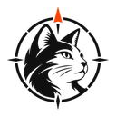

ヘッダー・ファビコン・発行主体の表示。表情キャラで置き換えない。

状態：`canonical-logo` · [原本PNG](../cat-compass-logo-source.png)

## 既存の案内役C：後ろ姿とリュック

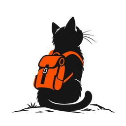

既存の入口・案内に使う後ろ姿。正式ロゴとは役割が違う。

状態：`canonical-existing-companion` · [原本PNG](../explorer-cat-companion-source.png)

## FIELD NOTES：機械の分解図

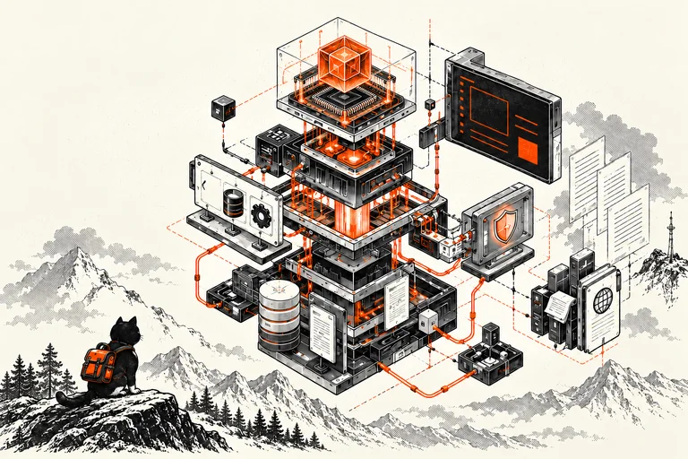

サイトの世界観。脳を除いた承認済みの機械版を使う。

状態：`approved-scene` · [原本PNG](../field-notes-hero.png)

## APIキーを設定する場面

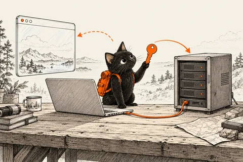

記事用の黒猫の顔立ち・毛並み・リュックの参照元。矢印は場面のイメージ。

状態：`canonical-editorial-character` · [原本PNG](../reading-scenes/api-key-scene.png)

## 実行環境を調べる場面

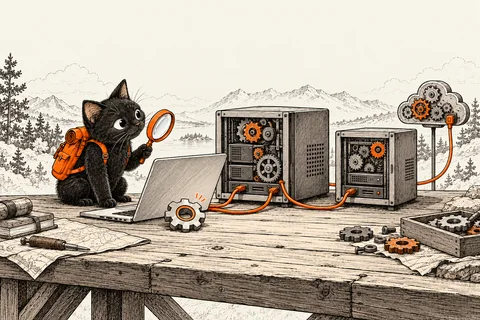

Node.jsカードと実行中の版の話題。機械の歯車は実行環境の比喩。

状態：`approved-scene` · [原本PNG](../reading-scenes/node-runtime-scene.png)

## ポーズ9種

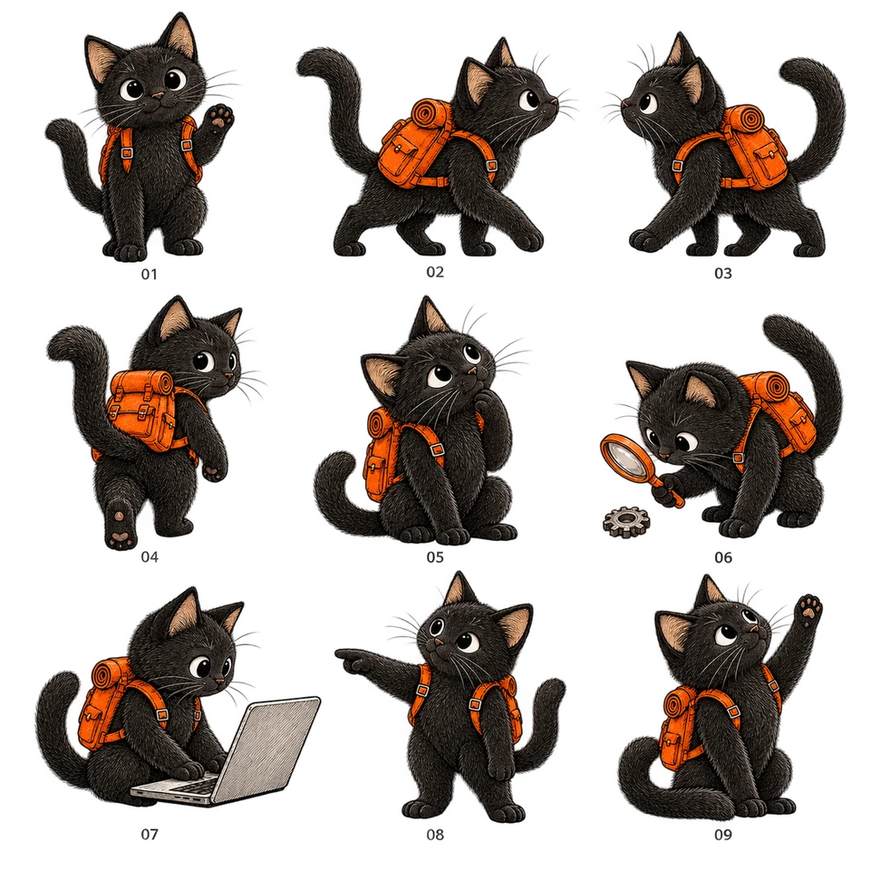

構図と向きの参考。顔立ちは修正版表情とAPIキー挿絵に合わせる。

状態：`approved-pose-reference` · [原本PNG](sources/explorer-cat-nine-poses.png)

## カードからのぞく6種

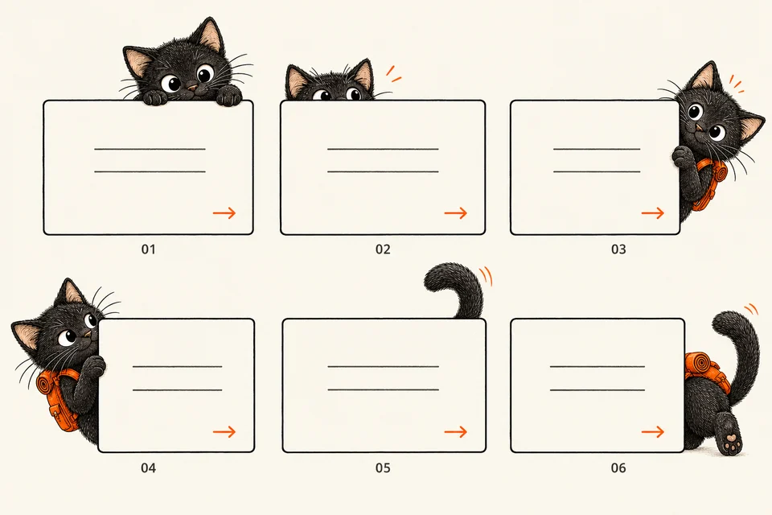

上・左右・尻尾・後ろ姿。カード枠や番号は配置の見本で、画像ごと記事へ貼らない。

状態：`approved-layout-reference` · [原本PNG](sources/explorer-cat-peeking-cards.png)

## 肉球スタンプ6種

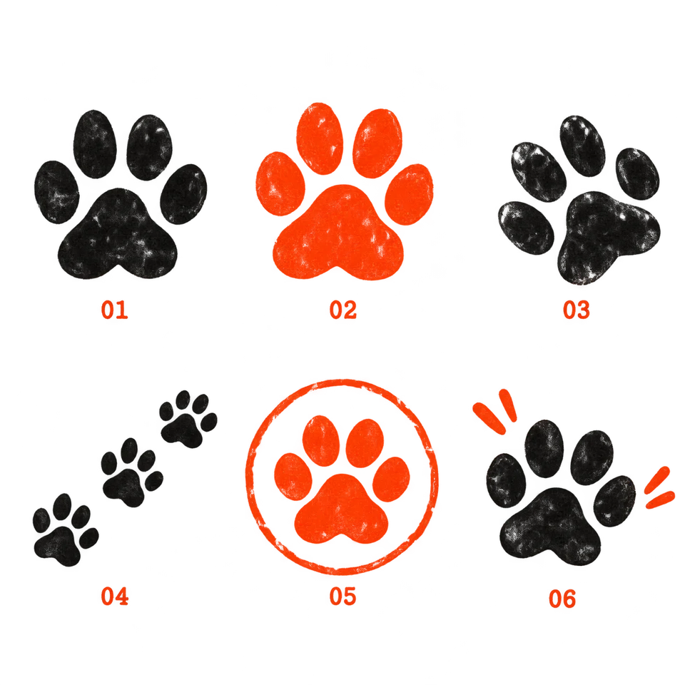

黒・朱色・足跡・丸枠。安全や対応完了を保証する印にはしない。

状態：`approved-decoration-reference` · [原本PNG](sources/explorer-cat-paw-stamps.png)

## 元の顔立ちに寄せた表情6種

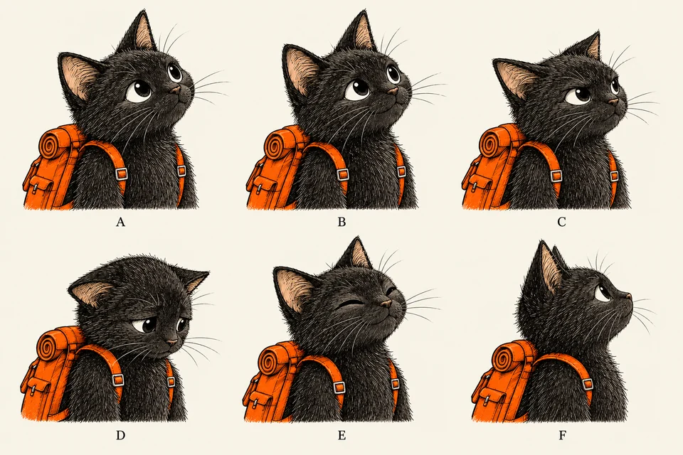

表情の現行基準。A/Fを基本、Eは穏やかな喜び。顔を丸くしすぎない。

状態：`approved-expression-reference` · [原本PNG](sources/explorer-cat-expressions-original-style.png)

## 採用しない旧案

顔が大きく丸くなった旧「喜怒哀楽4種」は、現行の顔立ちの参照に使いません。修正版の6種を正本として扱います。

機械向けの一覧・寸法・透過情報・SHA-256は[catalog.json](./catalog.json)を参照してください。採用判断の記録は[approval-record.md](./approval-record.md)。

## 調べる猫：個別透過素材

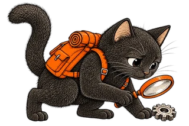

確認する記事の導入。承認済みポーズ06を元の顔立ちへ寄せて個別化。

[原本PNG](./sources/cat-investigate-cutout.png) · 個別素材化済み

## 上からのぞく猫：個別透過素材

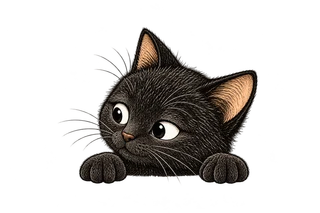

カード上の補足。修正版表情Aを参照。文字と重ならない余白を確保。

[原本PNG](./sources/cat-peek-cutout.png) · 個別素材化済み

## オレンジの肉球：個別透過素材

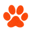

節の区切りの装飾。完了や安全の保証にしない。

[原本PNG](./sources/paw-orange-cutout.png) · 個別素材化済み

## 全記事への採用素材 / 2026-10-24

承認済みのポーズ・配置・修正版表情から個別素材を作り、実際の記事に配置。新しい場面の挿絵も併用。配置先は [記事別一覧](../../ARTICLE_VISUALS_REVIEW.md)。

### data-sorting-scene

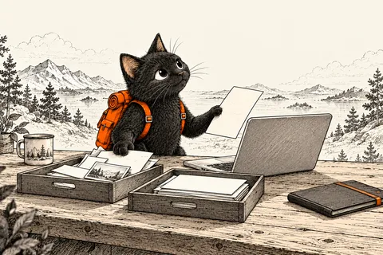

[原本](./sources/data-sorting-scene.png)

### access-gate-scene

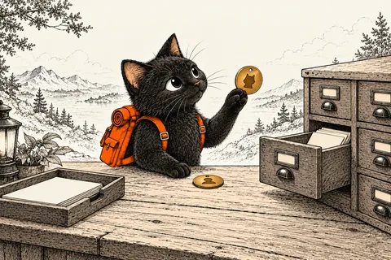

[原本](./sources/access-gate-scene.png)

### connection-map-scene

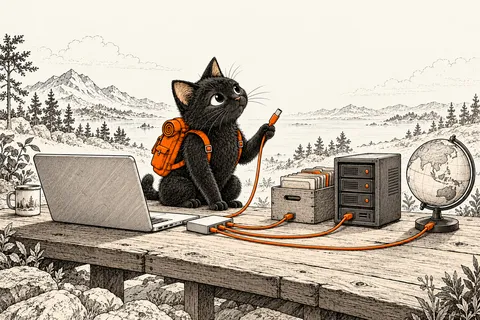

[原本](./sources/connection-map-scene.png)

### release-preparation-scene

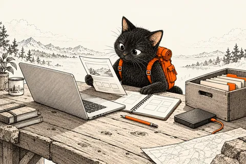

[原本](./sources/release-preparation-scene.png)

### incident-notes-scene

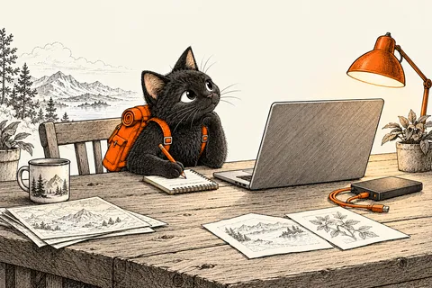

[原本](./sources/incident-notes-scene.png)

### review-workbench-scene

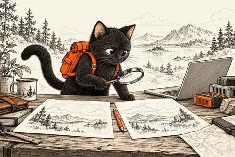

[原本](./sources/review-workbench-scene.png)

### cat-walk-right

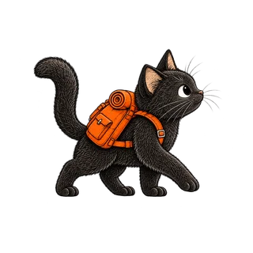

[原本](./sources/cat-walk-right.png)

### cat-think

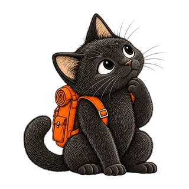

[原本](./sources/cat-think.png)

### cat-laptop

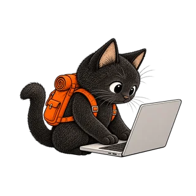

[原本](./sources/cat-laptop.png)

### cat-point

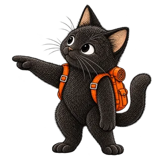

[原本](./sources/cat-point.png)

### cat-peek-side

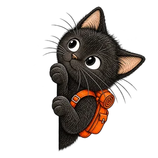

[原本](./sources/cat-peek-side.png)

### cat-tail

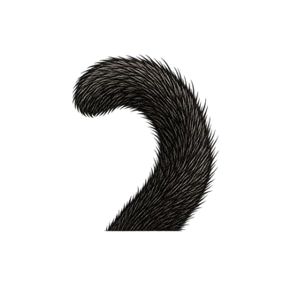

[原本](./sources/cat-tail.png)

### cat-smile

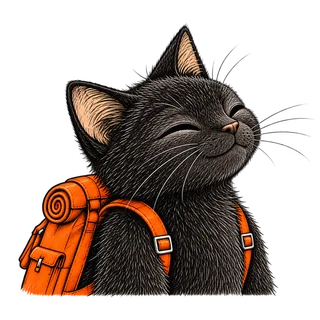

[原本](./sources/cat-smile.png)

### cat-concern

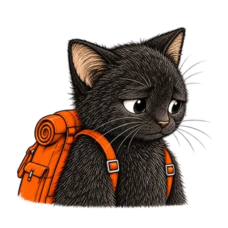

[原本](./sources/cat-concern.png)
